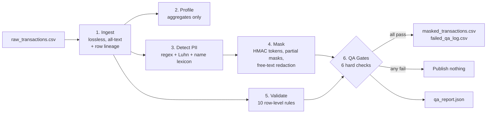
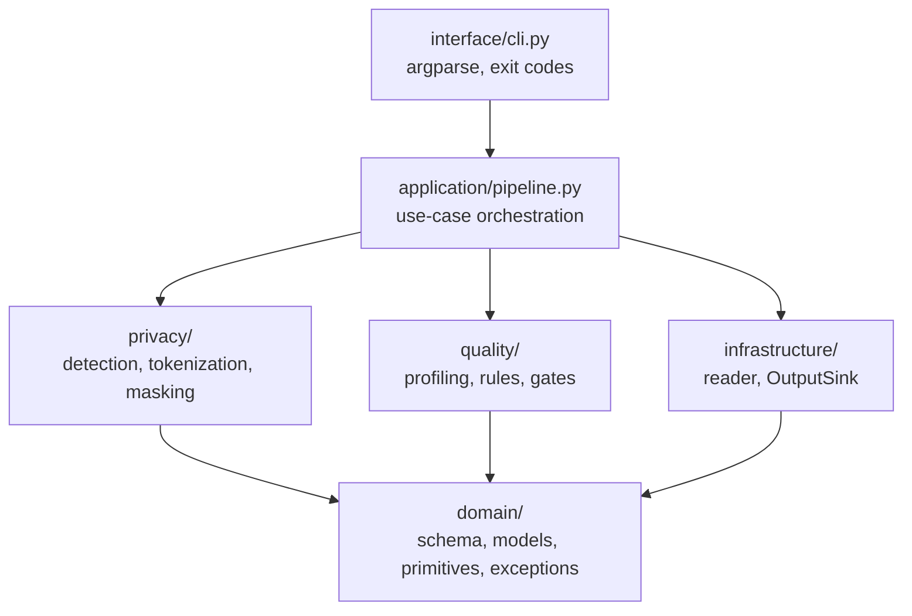
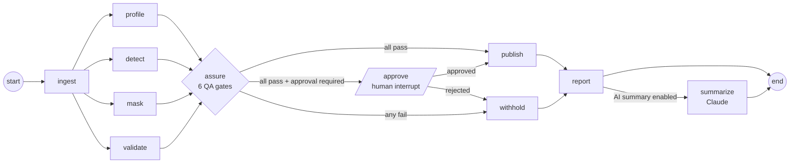

# SafeData Fintech QA

**Automated PII governance, data-quality validation and financial reconciliation for AI-ready Fintech datasets.**

[](https://github.com/feudson97-a11y/safedata-fintech-qa/actions/workflows/ci.yml)    

---

## Project Overview

Financial institutions sit on transaction data that is enormously valuable for analytics and for training machine-learning and LLM systems, and almost none of it can be used safely in its raw form. Customer names, emails, phone numbers and card numbers appear not only in well-defined columns but also buried inside free-text fields such as support-agent notes, where traditional column-level masking never looks.

This project is a self-contained, production-style pipeline that converts a raw transaction extract into a dataset that is:

- **Privacy-safe**: every structured and unstructured PII value is irreversibly masked or tokenised, and an independent leak scan proves it.
- **Analytically intact**: transaction amounts and dates are passed through byte-for-byte, and the financial control total reconciles to the cent.
- **Quality-assured**: malformed, duplicate and statistically anomalous rows are isolated with machine-readable failure reasons instead of silently contaminating downstream models.
- **Auditable**: every run emits a JSON report with input hash, profile, detection results, rule counts and gate outcomes, containing aggregates only and never raw values.

### Why this matters for AI training data

A model trained on data containing PII can memorise and regurgitate it. A model trained on silently corrupted data (duplicated transactions, sign errors, impossible dates) learns the corruption. This pipeline treats both as release-blocking defects: **if any QA gate fails, no row-level data is published.**

### Results on the reference dataset (10,000 rows, seed 42)

| Metric | Result |
|---|---|
| Notes containing hidden PII detected and redacted | 4,494 (44.9%) |
| Raw PII values found in published output | **0** |
| Injected defects caught (ground-truth recall) | **200 / 200 (100%)** |
| Source amount total vs. clean + quarantined | $1,258,478.06 = $960,605.23 + $297,872.83 (variance **$0.00**) |
| Amount / date values altered | **0** |
| Rows quarantined | 229 (2.29%) |
| Runtime | ~1.9 s (10k rows), ~24 s (100k rows), single process |

---

## Architecture & Pipeline Workflow



| Stage | What it does | Key design choice |
|---|---|---|
| **1. Ingest** | Loads the CSV with every field as text and NA-inference disabled; attaches `Source_Row_Number` lineage. | Lossless read: malformed values, leading zeros and exact decimal strings are preserved so validation sees what the source system actually sent. |
| **2. Profile** | Completeness, cardinality, parseability and value ranges per column. | Contains no raw values, so the profile is safe to share. |
| **3. Detect** | Scans *every* column for emails, phones, card numbers (13–19 digits) and person names; classifies each column. | Undeclared columns containing PII are flagged as schema drift and fail the run. |
| **4. Mask** | Tokenises identifiers, partially masks contact fields, redacts PII inside free text. | Amounts and dates are copied, never transformed: integrity by construction. |
| **5. Validate** | Applies business rules to raw values; failing rows are routed to quarantine. | Quarantined rows are masked too: the failure log is as safe as the clean output. |
| **6. Assure** | Six hard QA gates (below). | Fail-closed: any failure withholds all row-level output. |
| **7. Publish** | Atomic writes (temp file + rename) of outputs and the audit report. | Consumers never observe a partially written file. |

### Code architecture

The package follows a layered (Clean Architecture) design: dependencies point inward, business rules never touch the file system, and storage is reached only through a port.



| Layer | Responsibility |
|---|---|
| `domain` | Data contract (`schema.py`), immutable value objects and enums, pure helpers (Luhn, exact cents), typed exception hierarchy. No I/O. |
| `privacy` | PII patterns, name lexicon, HMAC tokenizer, structured masking and free-text redaction. |
| `quality` | Aggregate profiling, row-level `ValidationRule`s, dataset-level QA gates. |
| `infrastructure` | Lossless CSV reader and the `OutputSink` protocol with an atomic `LocalDirectorySink`. A cloud sink (e.g., S3) would implement the same protocol without changing the pipeline. |
| `application` | Orchestrates the use case and enforces all-or-nothing publication. |
| `interface` | Unified `safedata` CLI with typed exit codes. |
| `synthetic` | Reproducible test-data generator with a ground-truth defect manifest. |

### Masking strategy

| Field | Technique | Example output | Rationale |
|---|---|---|---|
| `Customer_Name` | HMAC-SHA256 token, column renamed `Customer_Token` | `CUST_5f37274124779742` | Irreversible, yet stable, so customer-level joins and distinct counts still work. |
| `Credit_Card_Number` | PCI-style truncation **plus** `Card_Token` | `****-****-****-6455` / `CARD_4c68b4b0daac5188` | Last four digits support customer service; the token supports card-level analytics. |
| `Email_Address` | Partial mask | `j***@gmail.com` | Domain retained for analytics (e.g., provider mix); malformed values fully redacted. |
| `Phone_Number` | Last four digits only | `***-***-0558` | Standard verification pattern. |
| `Transaction_Notes` | Entity redaction + email partial mask | `Account holder [REDACTED_NAME] (a***@fintechmail.io) flagged...` | Sentence meaning preserved for NLP use; `Notes_PII_Entities` records what was removed. |
| `Transaction_Amount`, `Transaction_Date` | **Untouched** | identical to source | Required for analytics; verified byte-for-byte by a QA gate. |

> **Why HMAC rather than a plain SHA-256 hash?** The card-number space is small enough that an unsalted hash can be reversed by brute force in hours. Keying the hash with a secret held outside the dataset (`SAFEDATA_HMAC_KEY`) defeats dictionary attacks while keeping tokens deterministic. Only a key *fingerprint* is written to the audit report, so key rotation is traceable without exposing the key.

### Free-text PII detection

Redaction runs in a deliberate order so that one entity cannot mask another's detection:

1. **Emails**: RFC-style pattern; replaced with the partial mask.
2. **Card numbers**: any run of 13–19 digits with optional space or dash separators. This is *fail-closed*: digit runs are redacted whether or not they pass the Luhn check, because a mistyped card number is still sensitive.
3. **Phone numbers**: NANP formats including `(415) 555-0123`, `415.555.0123`, `+1 415 555 0123` and bare 10-digit strings.
4. **Names**: three complementary signals: honorific + surname (`Ms. O'Brien`); adjacent capitalised words matching the first/last-name lexicon learned from `Customer_Name` (catches *other* customers mentioned in a note); and any token of the row's own customer name (catches `...shipped to Priya`).

---

## QA & Validation Framework

The framework separates **row-level rules**, which quarantine individual bad records, from **dataset-level gates**, which decide whether anything is released at all.

### Row-level validation rules

Evaluated on raw values; a row failing one or more rules is written to `failed_qa_log.csv` with `Failed_Rules` (semicolon-separated) and `Rule_Count`.

| Rule | Catches |
|---|---|
| `MISSING_TRANSACTION_ID` | Blank primary key |
| `DUPLICATE_TRANSACTION_ID` | Every occurrence of a repeated ID (not only the second), so analysts can resolve which record is authoritative |
| `INVALID_AMOUNT_FORMAT` | `N/A`, empty, `12.3.4`, `USD 45.00`, more than two decimals |
| `NON_POSITIVE_AMOUNT` | Zero or negative amounts (sign errors, unflagged refunds) |
| `AMOUNT_OUTLIER` | Modified z-score of log(amount) > 3.5 **within each merchant category** (median/MAD, so the outliers cannot distort their own baseline) |
| `INVALID_DATE` | Unparseable or wrongly formatted timestamps |
| `FUTURE_DATE` / `DATE_BEFORE_MIN` | Timestamps after the run time or before the configured floor |
| `INVALID_MERCHANT_CATEGORY` | Values outside the controlled vocabulary, including case and whitespace variants |
| `INVALID_EMAIL_FORMAT` | Structurally invalid addresses |
| `INVALID_CARD_NUMBER` | Wrong length, illegal characters or a failed Luhn checksum |

### Dataset-level QA gates (release blockers)

| Gate | Requirement | How it is proven |
|---|---|---|
| `ZERO_PII_LEAKAGE` | 100% of PII masked | **Two independent tests.** (A) Re-run every detector over every published column. (B) For each published row, confirm none of *that row's original* email, phone, card or name tokens appear anywhere in it. Token columns are checked against a strict format regex instead, since random hex can coincidentally resemble digit runs. |
| `FINANCIAL_RECONCILIATION` | Sum of `Transaction_Amount` matches exactly | Control totals computed in integer cents via `Decimal` (no floating-point drift): `source = clean + quarantined`, plus parseable/unparseable counts. |
| `ANALYTIC_FIELD_INTEGRITY` | Amounts and dates statistically and structurally untouched | Byte-for-byte comparison per `Source_Row_Number`, plus mean/std/min/max before vs. after. |
| `ROW_CONSERVATION` | No row lost or duplicated | Source row set equals the disjoint union of clean and quarantined row sets. |
| `SCHEMA_AND_PII_DRIFT` | No unexpected PII-bearing columns | Any column not declared in the masking config that contains PII fails the run. |
| `QUARANTINE_RATE_WITHIN_TOLERANCE` | Quarantine below 5% (configurable) | A spike usually signals an upstream extract failure, not bad customers. |

### How the framework itself is verified

A validation framework is only credible if it is shown to catch failures, not just to pass:

- **Ground-truth recall.** The generator writes `injected_defects.csv`, listing every deliberately corrupted row and the defect type. The test suite asserts that 100% of them are quarantined.
- **Negative tests.** The suite simulates a masking regression (redaction disabled) and asserts that the leak gate fails, that no dataset is published, and that the audit report itself does not contain the leaked values. Further tests tamper with an amount to break reconciliation and add an undeclared `Backup_Contact` column to trigger the drift gate.
- **Unit tests** cover Luhn validation, every masking function, token determinism and key separation, exact decimal handling, configuration validation, and free-text redaction edge cases (`O'Brien`, first-name-only mentions, PII-free notes left untouched). A contract test guarantees the generator and the schema share one merchant-category vocabulary.
- **Continuous integration.** GitHub Actions runs `ruff` linting and formatting checks, then the full test suite plus an end-to-end smoke run on Ubuntu and Windows across Python 3.11, 3.12, 3.13 and 3.14.

---

## Quick Start

**Prerequisites:** Python 3.11 or later (`python --version`).

```bash
# 1. Clone and install (editable mode, with the dev tooling)
git clone https://github.com/feudson97-a11y/safedata-fintech-qa.git
cd safedata-fintech-qa
python -m venv .venv
source .venv/bin/activate          # Windows PowerShell: .venv\Scripts\Activate.ps1
pip install -e ".[dev]"

# 2. Generate the synthetic dataset (10,000 rows -> data/raw_transactions.csv)
safedata generate

# 3. Set a tokenisation key (omit for an ephemeral key; tokens then change every run)
export SAFEDATA_HMAC_KEY="replace-with-a-long-random-secret"     # PowerShell: $env:SAFEDATA_HMAC_KEY="..."

# 4. Run the pipeline
safedata run

# 5. Run the tests and the linter
python -m unittest discover -s tests -t . -v
ruff check . && ruff format --check .
```

`python -m safedata <command>` works identically if the `safedata` script is not on your `PATH`.

### Outputs (`output/`)

| File | Contents |
|---|---|
| `masked_transactions.csv` | Clean, masked, analytics-ready rows |
| `failed_qa_log.csv` | Quarantined rows (also masked) with `Failed_Rules` and `Rule_Count` |
| `qa_report.json` | Run metadata, input SHA-256, profile, detection results, masking stats, rule counts, gate outcomes |

### Configuration

| Command / option | Default | Description |
|---|---|---|
| `safedata run --input` | `data/raw_transactions.csv` | Source extract |
| `safedata run --output-dir` | `output` | Destination directory |
| `safedata run --outlier-z` | `3.5` | Modified z-score threshold for amount outliers |
| `safedata run --max-quarantine-rate` | `0.05` | Gate threshold for the share of quarantined rows |
| `safedata generate --rows / --seed / --defect-rate / --output` | `10000` / `42` / `0.02` / `data/raw_transactions.csv` | Synthetic data options |
| `safedata --log-level` | `INFO` | Global: `DEBUG`, `INFO`, `WARNING` or `ERROR` |
| `SAFEDATA_HMAC_KEY` (env) | *ephemeral* | Secret for deterministic tokenisation; store it in a secrets manager in production |

**Exit codes:** `0` all gates passed · `1` a QA gate failed and data was withheld · `2` input or configuration error · `3` unexpected error (traceback logged). These make the pipeline directly usable as a CI/CD or orchestrator (Airflow, Dagster, cron) step.

---

## Project Structure

```
safedata-fintech-qa/
├── pyproject.toml                  # Packaging, dependencies, `safedata` entry point, ruff config
├── .github/workflows/ci.yml        # Lint + tests on Ubuntu/Windows, Python 3.11-3.14
├── src/safedata/
│   ├── domain/                     # schema.py, models.py, primitives.py, exceptions.py
│   ├── privacy/                    # patterns.py, detection.py, tokenization.py, masking.py
│   ├── quality/                    # profiling.py, rules.py, gates.py
│   ├── infrastructure/             # reader.py, sinks.py, llm.py (optional Claude summarizer)
│   ├── application/pipeline.py     # Ingest -> Profile -> Detect -> Mask -> Validate -> Assure -> Publish
│   ├── application/graph.py        # Optional LangGraph engine (parallel branches, approval, AI summary)
│   ├── interface/cli.py            # `safedata generate` / `safedata run`
│   └── synthetic/generator.py      # Synthetic data + ground-truth defect manifest
├── tests/
│   ├── unit/                       # primitives, contracts, masking, tokenization, redaction
│   └── integration/                # end-to-end, fail-closed negative tests, CLI exit codes
├── data/                           # generated input (git-ignored)
└── output/                         # pipeline outputs (git-ignored)
```

---

## Optional LangGraph Engine

The same use case can be orchestrated as a [LangGraph](https://github.com/langchain-ai/langgraph) `StateGraph`. It is strictly opt-in: the default engine, the core dependencies (`pandas`, `numpy`) and the main CI matrix are unchanged.

```bash
pip install -e ".[agentic]"
safedata run --engine langgraph
```



- **Same business code**: every node calls the existing `privacy`, `quality` and `infrastructure` functions; no rule is duplicated.
- **Same guarantees**: all-or-nothing publication is a conditional edge (`publish` vs `withhold`).
- **Proven parity**: `tests/integration/test_graph_engine.py` asserts byte-identical outputs and an identical audit report versus the classic engine, on both a passing run and a fail-closed masking regression. The report adds only `run.engine = "langgraph"`.
- **Isolated CI**: a separate `agentic` job installs the extra; the parity tests are skipped when LangGraph is absent.
- **No disruption**: both extensions below are off by default; without them the graph behaves exactly as above.

### Human approval (`--require-approval`)

When every QA gate passes, the graph pauses with a LangGraph `interrupt` and shows the reviewer aggregates only (row counts, reconciliation, gate outcomes):

```text
=== Approval required before publishing ===
Rows: 2,000 total | 1,955 clean | 45 quarantined
Reconciliation: 224888.90 = 192892.31 + 31996.59 (variance 0.00)
  PASS  ZERO_PII_LEAKAGE
  ...
Publish masked dataset? [y/N]
```

- Rejection withholds all row-level output; the run is reported as `REJECTED` (exit code 1).
- Fail-closed: anything other than an explicit yes, or a non-interactive session (CI, cron), rejects.
- Runs whose gates fail are never offered for approval.
- The checkpointer is in-memory and process-local by design: graph state holds raw rows and must never be persisted. Per-run dependencies (config, tokenizer, sink) travel in the LangGraph runtime context, not in checkpointed state.

### AI summary (`--ai-summary`)

After `qa_report.json` is written, Claude turns it into `qa_summary.md` (verdict, key figures, top issues, recommended actions) for a data steward.

```bash
export ANTHROPIC_API_KEY=...                  # PowerShell: $env:ANTHROPIC_API_KEY = "..."
safedata run --engine langgraph --ai-summary  # model: --summary-model or SAFEDATA_SUMMARY_MODEL
```

- Only the aggregates-only audit report is sent to the API, never row-level data.
- Advisory: an API error is logged and never changes the run outcome or exit code.
- Fails fast (exit code 2) before any processing if the SDK or API key is missing.


---

## Design Decisions & Limitations

**Deliberate trade-offs**

- *Fail-closed over fail-open.* Unknown PII columns, unvalidated tokens and any gate failure block release. In a regulated environment, a delayed dataset is recoverable; a leaked one is not.
- *Masked quarantine.* The failure log goes to data stewards who do not need raw PII to triage a malformed date.
- *Rules on raw, release on masked.* Validation inspects original values (e.g., Luhn on the real PAN), but nothing downstream of the masking stage ever sees them.

**Known limitations and roadmap**

- **Name detection** relies on a lexicon learned from the structured name column, plus honorific patterns. Names that never appear in `Customer_Name` and lack an honorific can be missed. A production deployment would add an NER model (e.g., spaCy or Microsoft Presidio) as an additional detector feeding the same leak gate.
- **Phone patterns** target North American numbers; international (E.164) formats would be added for multi-region data.
- **Scale.** Throughput is roughly 4,000 rows/second in a single process with whole-file processing. For tens of millions of rows the stages are designed to move to chunked or partitioned execution (masking and rules are row-local; outlier baselines and reconciliation would become a two-pass aggregate), or to a distributed engine such as Spark or Polars.
- **Key management.** The HMAC key is read from an environment variable; production use would source it from a KMS or secrets manager with scheduled rotation.

---

## License

Released under the MIT License (see `LICENSE`).

## Disclaimer

All data in this repository is synthetic and generated from a seeded random number generator. Card numbers are randomly generated and Luhn-valid only for format realism; no real person, card or phone number is represented.
